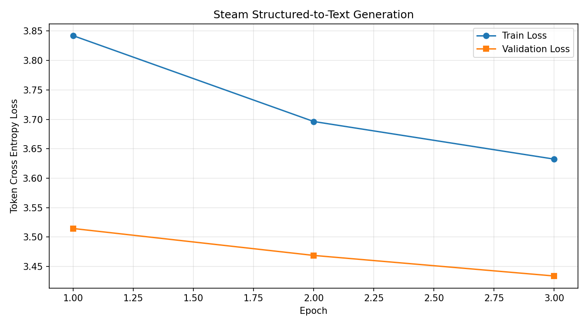

# 基于 FLAN-T5 的 Steam 结构化数据文本生成技术报告

本项目使用 Steam 游戏的名称、类型、发行信息等结构化属性作为输入，微调 `google/flan-t5-small`，生成对应的游戏简介。任务属于条件文本生成：模型学习结构化属性与自然语言描述之间的关系，输出目标为数据集中的 `short_description`。

本报告依据当前项目代码、本地 CSV 的统计结果以及 `训练过程/train_report.txt` 编写。数据统计对应本地下载版本，实验结果对应日志中已完成的三轮训练。

## 1. 数据理解与预处理

### 1.1 数据概况

数据来源为 [Kaggle Steam Games Dataset All Games](https://www.kaggle.com/datasets/hubertsidorowicz/steam-games-dataset-daily-updates)，本地文件为 `steam_games.csv`。该数据集持续更新，以下统计仅对应本地文件，不代表后续版本。

| 项目 | 本地文件统计 |
|---|---:|
| 文件大小 | 1,014,731,479 字节，约 1.01 GB |
| 原始记录数 | 144,015 |
| 原始字段数 | 42 |
| 输入字段数 | 17 |
| 简介清洗后非空记录数 | 135,683 |
| 按当前流程过滤并对简介去重后的记录数 | 134,228 |
| 本次配置使用的样本数 | 5,000 |

数据读取路径以 `setting.py` 所在目录为基准，因此从其他工作目录启动程序时也能定位本地 CSV。读取时仅载入 17 个输入字段和目标简介，减少对图片链接、长描述等无关列的内存占用；当前代码仍需扫描完整 CSV，并在清洗后截取样本。

### 1.2 特征分类

按照语义将输入属性划分为六组，与 `data.py` 中的 `FIELD_GROUPS` 保持一致。

| 分类 | 使用字段 | 信息作用 |
|---|---|---|
| 游戏名称 | `name` | 标识游戏名称 |
| 发行信息 | `release_date`、`developers`、`publishers` | 提供发行时间、开发商和发行商 |
| 类型与标签 | `genres`、`categories`、`tags` | 提供类型、功能分类和内容标签 |
| 玩法与平台 | `windows`、`mac`、`linux` | 提供操作系统支持信息；其他玩法信息主要来自类别和标签 |
| 价格与内容 | `price`、`price_status`、`dlc_count` | 提供价格状态及附加内容数量 |
| 玩家反馈 | `metacritic_score`、`positive`、`negative`、`recommendations` | 提供评分和玩家反馈统计 |

目标字段 `short_description` 不进入模型输入。`about_the_game` 和 `detailed_description` 也不作为特征，避免通过其他描述列直接复制目标内容。

### 1.3 缺失值与文本清洗

预处理将缺失值及 `nan`、`none`、`null`、`n/a`、`-` 等内容转为空字符串，使用正则表达式去除 HTML 标签并合并连续空白。目标简介为空的记录被删除，输入中的空属性在序列化时跳过。

清洗后按照完整目标简介去重，同一清洗后简介只保留第一条记录。这能够减少重复文本，但也可能删除使用相同简介的不同游戏。当前流程没有按游戏系列或开发商进行分组划分。

代码中的空输入检查对已经添加任务提示的文本执行正则匹配，其效果不能等同于严格检查“至少一个属性非空”。后续应在拼接提示前检查实际有效属性数量。

### 1.4 结构化属性编码

各字段采用“字段名: 字段值”的形式，按语义类别拼接为文本，再添加任务提示。数值、类别和布尔属性均转为字符串，不进行标准化或独热编码。

以下为格式示意，不是模型生成结果：

```text
根据以下 Steam 游戏结构化信息生成简洁、准确的游戏简介：
游戏名称 — name: Example Adventure
类型与标签 — genres: Adventure, Indie; tags: Exploration
玩法与平台 — windows: True; mac: False; linux: False
价格与内容 — price: 9.99; dlc_count: 0
```

分词器将输入转换为 `input_ids` 和 `attention_mask`。输入最多保留 256 个 token，目标最多保留 128 个 token，不足部分补齐，超长部分截断。目标中的补齐 token 被替换为 `-100`，不参与损失计算。

任务提示使用中文，监督目标直接沿用原始简介语言，没有执行翻译或语言筛选。因此，本实验不能据此声称实现了中文简介生成。

### 1.5 数据划分

当前实现按文件顺序取清洗后前 5,000 条有效记录，然后以随机种子 42 按 80% / 20% 随机划分。根据当前配置和复核后的有效样本量，划分规模为：

| 数据用途 | 样本数 | batch size | 每轮批次数 |
|---|---:|---:|---:|
| 训练 | 4,000 | 8 | 500 |
| 验证 | 1,000 | 8 | 125 |

代码中的 `test_loader` 实际用于每轮验证和最佳模型选择，因此报告将其称为验证集。本实验没有独立保留最终测试集。上述样本数由当前数据及代码复核得到，原训练日志没有单独记录划分样本数。

## 2. 模型和超参数

### 2.1 模型定义

项目通过 `AutoModelForSeq2SeqLM.from_pretrained` 加载 `google/flan-t5-small`，由 `SteamTextGenerator` 封装。编码器读取属性文本，解码器结合编码器输出及已有目标上下文，逐个预测后续 token。训练时使用预训练权重初始化，并更新全部模型参数。

给定属性序列 \(x\) 和目标简介 \(y\)，条件生成过程表示为：

\[
P(y\mid x)=\prod_{t=1}^{T}P(y_t\mid y_{<t},x)
\]

模型训练的目标是提高真实简介 token 在给定结构化信息下的预测概率。

### 2.2 损失函数与优化方法

训练使用模型返回的 token 交叉熵损失。对一个批次中的有效目标 token，其损失可表示为：

\[
\mathcal{L}=-\frac{1}{N}\sum_{i,t:\,y_{i,t}\ne-100}
\log P(y_{i,t}\mid y_{i,<t},x_i)
\]

其中 \(N\) 为该批次有效目标 token 数。训练采用 AdamW，每个批次执行梯度清零、前向计算、反向传播、梯度裁剪和参数更新。梯度范数上限为 1.0。

日志中的每轮 Loss 是各批次 Loss 的算术平均值，而不是按整轮有效 token 总数重新加权的平均值。训练使用 `model.train()`，验证使用评估模式并关闭梯度计算。

### 2.3 超参数

| 参数 | 当前设置 |
|---|---|
| 预训练模型 | `google/flan-t5-small` |
| 输入最大长度 | 256 token |
| 目标最大长度 | 128 token |
| Batch size | 8 |
| Epochs | 3 |
| 学习率 | 0.00003 |
| 优化器 | AdamW |
| 梯度裁剪范数 | 1.0 |
| 随机种子 | 42 |
| 验证比例 | 20% |
| DataLoader 工作进程数 | 0 |
| 本次日志记录的设备 | CPU |

当前设备选择逻辑仅检测 CUDA，否则使用 CPU，尚未启用 Apple MPS。固定随机种子有助于复现实验，但不同硬件、依赖版本及计算实现仍可能影响结果。

### 2.4 评估指标

本次实际记录了训练 Loss 和验证 Loss，并按最低验证 Loss 选择模型。Loss 反映监督目标的预测误差，不能直接解释为生成准确率。

本次未记录 ROUGE、BLEU、人工评分或字段事实一致性指标，也未保存可用于质量分析的生成样例。因此，结果分析限定在损失变化和训练耗时，不据此推断简介的可读性、事实准确性或实际使用效果。

## 3. 训练过程与结果

### 3.1 训练流程与实时进度

训练启动后依次读取数据、构建输入、划分样本、加载分词器和模型。每轮先执行训练，再计算验证损失。验证 Loss 改善时，模型保存到 `训练过程/best_model`。

训练和验证分别显示 `tqdm` 进度条，在每个批次结束后更新完成批次数、阶段耗时、阶段剩余时间、当前批次 Loss 和平均 Loss。每轮结束后，按照已完成轮次的平均耗时估算后续轮次所需时间。该估计会随运行情况变化。

### 3.2 实际训练记录

以下数值直接来自本地 `训练过程/train_report.txt`：

| Epoch | Train Loss | Validation Loss | 本轮耗时 | 累计耗时 |
|---|---:|---:|---:|---:|
| 1 | 3.8421 | 3.5145 | 10.7 分钟 | 10.7 分钟 |
| 2 | 3.6963 | 3.4687 | 11.0 分钟 | 21.7 分钟 |
| 3 | 3.6324 | 3.4338 | 11.7 分钟 | 33.4 分钟 |

三轮训练共进行约 1,500 次参数更新和 375 个验证批次。日志中的 33.4 分钟从训练循环开始计时，包括训练、验证和模型保存，不包括前面的 CSV 预处理、模型加载，以及循环结束后的绘图时间。

### 3.3 收敛曲线

下图为本次训练程序保存的损失曲线：



从第 1 轮到第 3 轮，训练 Loss 下降 0.2097，约为 5.46%；验证 Loss 下降 0.0807，约为 2.30%。三轮验证 Loss 均下降，最低值 3.4338 出现在第 3 轮，该轮对应本次选择的最佳模型。

验证 Loss 暂未出现反弹，但仅凭三轮记录不足以判断模型已经充分收敛。训练 Loss 高于验证 Loss 也不能单独视为异常：训练时启用训练模式且参数在一轮内持续更新，验证则使用该轮结束后的参数，两者计算条件不同。

### 3.4 输出文件与推理状态

| 文件 | 实际用途或状态 |
|---|---|
| `训练过程/train_report.txt` | 已记录三轮 Loss 和耗时 |
| `训练过程/training_curves.png` | 已生成训练与验证损失曲线 |
| `训练过程/best_model/model.safetensors` | 已保存模型权重 |
| `训练过程/best_model/config.json` | 已保存模型配置 |
| `训练过程/best_model/generation_config.json` | 已保存生成配置 |
| `generate.py` | 已提供结构化属性生成入口，尚无生成结果记录 |

生成脚本配置了最多 128 个新 token、4 路束搜索和三元组重复限制。当前保存逻辑只保存模型，最佳模型目录中尚无分词器文件，而生成脚本会尝试从该目录加载分词器。因此，在独立推理前仍需补存分词器，或明确从原预训练模型加载同一分词器；本报告不将推理流程描述为已验证通过。

## 4. 实验局限与改进方向

### 4.1 数据代表性与划分

前 5,000 条记录的选择依赖 CSV 排序，可能带来样本偏差。后续可在全量有效数据中随机抽样，并保留独立测试集；对于同系列或高度相似游戏，可进一步考虑分组划分，以更严格地检查对新游戏的泛化能力。

按目标简介去重只能处理完全相同的清洗后文本，无法排除近似简介或相关游戏跨集合出现。当前训练结果只适用于这次样本选择和划分方式。

### 4.2 输入信息与输出一致性

属性字段不能覆盖简介中的全部剧情和玩法细节，模型可能根据训练语料补写输入中不存在的内容。后续应检查生成结果是否保留游戏名称、类型、平台等明确属性，以及是否引入无法从输入确认的描述。

固定 256 token 的输入限制可能截断靠后的字段，长标签列表也会占用较多长度。可统计截断比例，再调整字段顺序、标签数量及输入长度。若目标明确为英文或中文生成，还应统一任务提示和监督文本的语言策略。

### 4.3 评估与工程完善

后续评估应同时保存生成文本与参考简介，结合自动文本指标和人工事实检查。若要评价微调带来的实际收益，还需要在同一数据划分上与未微调模型或模板生成方法进行对照。

工程方面应补齐分词器保存、统一训练与推理的字段格式，并在日志中记录样本数、依赖版本和数据文件校验信息。当前检查点不保存优化器状态，因此不支持完整恢复到中断时的训练状态。

## 5. 实验结论

本项目完成了 Steam 结构化属性到游戏简介的监督微调流程。当前 CPU 实验完成三轮训练，循环累计耗时约 33.4 分钟，最低验证 Loss 为 3.4338。损失下降表明模型在本次验证集上的目标文本预测误差有所降低；实际生成质量仍需通过推理样例、独立测试集及事实一致性评估进一步确认。

## 6. 项目文件对应关系

| 文件 | 职责 |
|---|---|
| `setting.py` | 数据路径、目标列、模型与训练超参数 |
| `data.py` | 字段分类、清洗、序列化、数据划分及分词 |
| `model.py` | 预训练序列到序列模型封装 |
| `train.py` | 训练、验证、实时进度、模型保存和曲线绘制 |
| `generate.py` | 根据结构化游戏属性生成简介 |
| `训练过程/train_report.txt` | 本报告实验数值的直接来源 |
